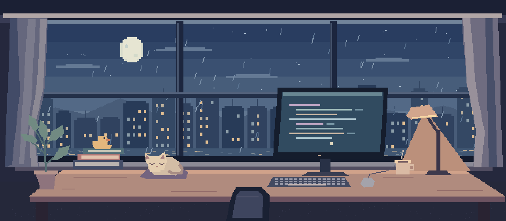

  <picture>
    <source media="(prefers-reduced-motion: reduce)" srcset="./assets/rainy-room.png">
    
  </picture>

  <picture>
    <source media="(max-width: 600px)" srcset="./assets/identity-mobile.svg">
    
  </picture>

  <a href="https://github.com/Drunkard-baifeng/go-chatgpt2api">go-chatgpt2api</a>
  &nbsp; · &nbsp;
  <a href="https://github.com/Drunkard-baifeng/public_golibs">public_golibs</a>
  &nbsp; · &nbsp;
  <a href="https://github.com/Drunkard-baifeng?tab=repositories">全部仓库</a>

